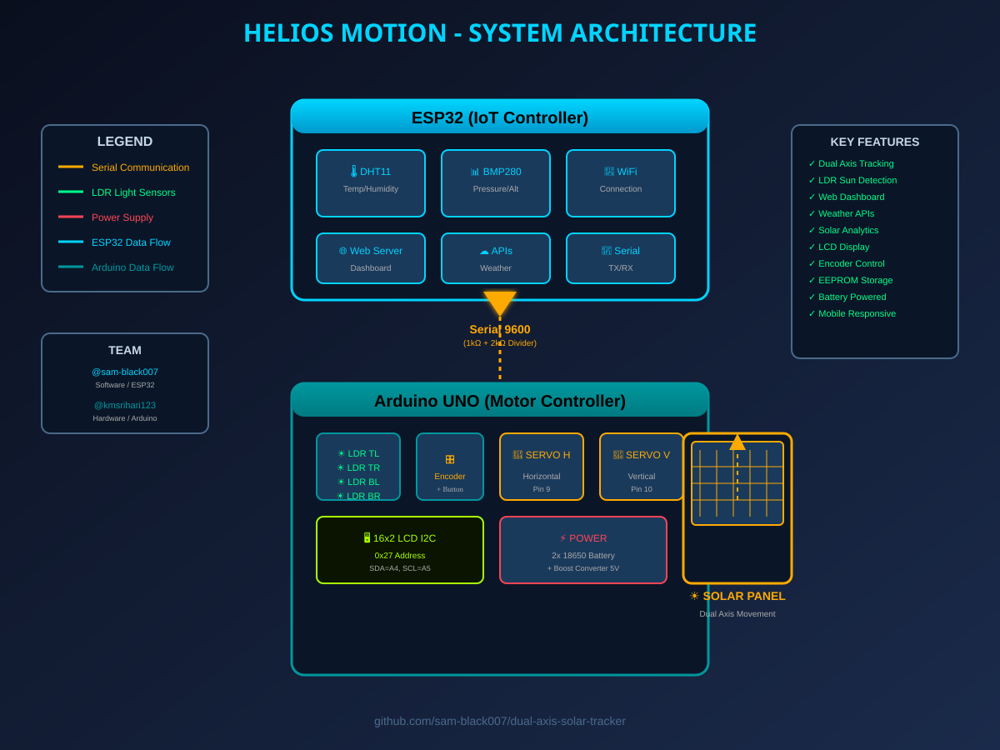
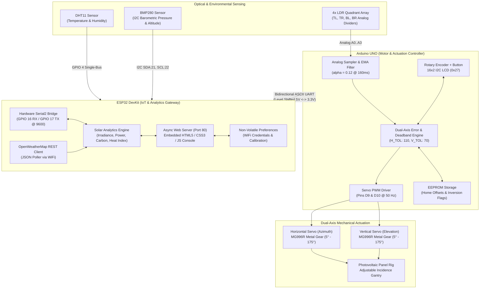
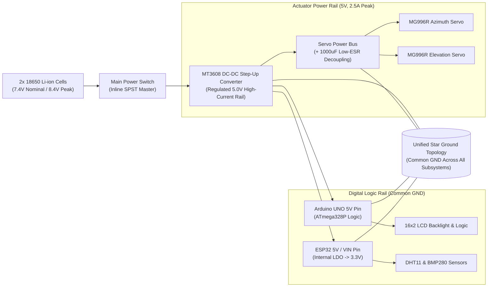
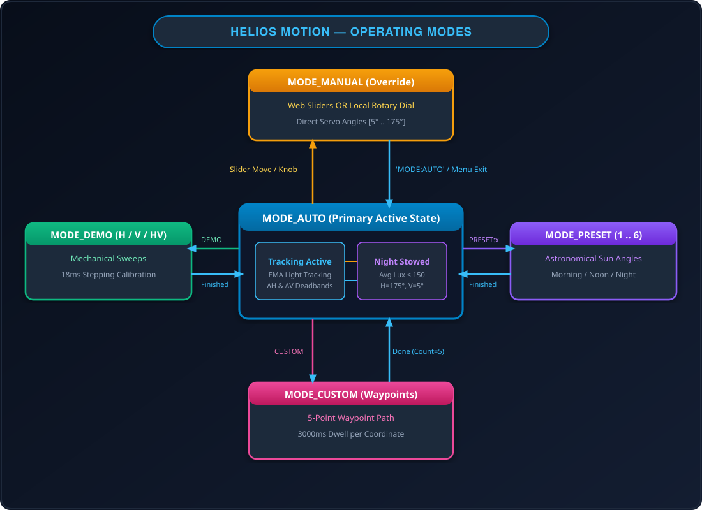
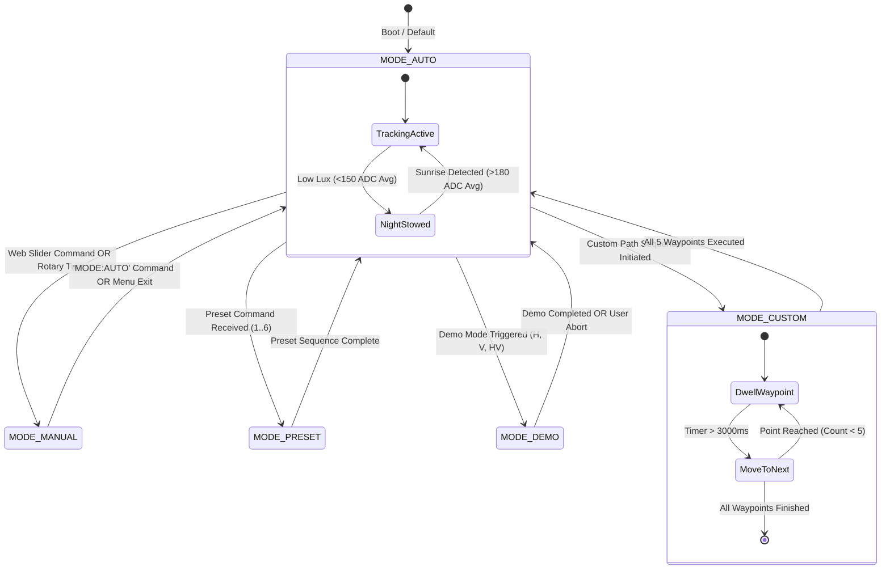
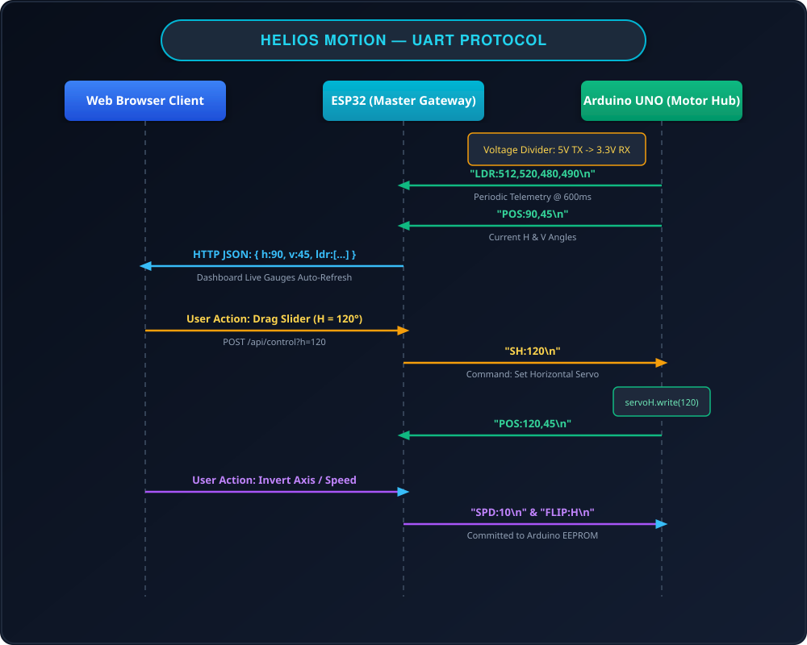
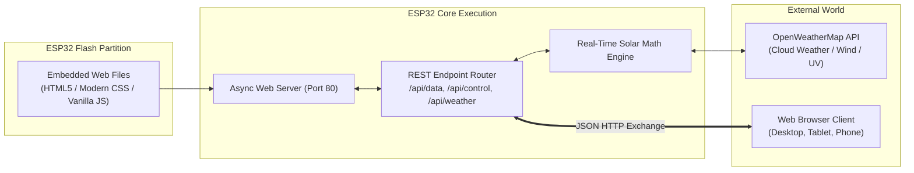

# ☀️ HELIOS MOTION — Intelligent Dual-Axis Solar Tracking System
### Autonomous High-Yield Photovoltaic Solar Tracking Workcell with Dual Microcontroller Architecture & Real-Time Embedded IoT Dashboard

[](https://github.com/sam-black007/helios-motion)
[-orange.svg)](https://github.com/sam-black007/helios-motion)
[-00599C.svg?logo=c%2B%2B&logoColor=white)](https://github.com/sam-black007/helios-motion)
[](https://github.com/sam-black007/helios-motion)
[](LICENSE-SOFTWARE.md)
[](https://github.com/sam-black007/helios-motion)
[](https://github.com/sam-black007/helios-motion/pulls)

**HELIOS MOTION** is an industrial-grade, autonomous dual-axis solar tracking platform engineered to maximize photovoltaic energy harvesting efficiency. By dynamically orienting solar panels perpendicularly toward the sun's direct normal irradiance (DNI) across both **azimuth (horizontal)** and **elevation (vertical)** axes, the system delivers an estimated **35% to 42% increase in annual energy yield** compared to traditional fixed-tilt solar installations.

Built upon a distributed **master-slave dual-microcontroller architecture**, the workcell separates high-frequency motor actuation, quadrant sensor filtering, and LCD menu control (**Arduino UNO**) from telemetry processing, environmental sensing (DHT11 + BMP280), OpenWeatherMap meteorological API polling, and a responsive dark-mode embedded web console (**ESP32**).

---

<p align="center">
  
</p>

---

## 👥 Engineering Team

| Contributor | Engineering Responsibilities | GitHub Profile |
|:---|:---|:---:|
| **Sam Joseph** | Software Architecture, ESP32 IoT Firmware, Web Dashboard UX/UI, Serial Protocol | [@sam-black007](https://github.com/sam-black007) |
| **K M Sri Hari** | Hardware Architecture, Circuit Design, Dual-Axis Actuation, Arduino UNO Firmware | [@kmsrihari123](https://github.com/kmsrihari123) |

---

## 📑 Table of Contents

- [Solar Physics & Efficiency Rationale](#-solar-physics--efficiency-rationale)
- [Key Features](#-key-features)
- [Distributed System Architecture (Flowchart)](#-distributed-system-architecture)
- [Power Delivery & Conversion Network (Flowchart)](#-power-delivery--conversion-network)
- [LDR Quadrant Optics & Tracking Mathematics (Flowchart)](#-ldr-quadrant-optics--tracking-mathematics)
- [Autonomous Sun-Tracking State Machine (Diagram)](#-autonomous-sun-tracking-state-machine)
- [Full-Duplex UART Communication Protocol (Diagram)](#-full-duplex-uart-communication-protocol)
- [Circuit Schematics & Hardware Pinout (Schematic)](#-circuit-schematics--hardware-pinout)
- [Embedded Web Console & Solar Analytics](#-embedded-web-console--solar-analytics)
- [Operating Modes & Trajectory Profiles](#-operating-modes--trajectory-profiles)
- [Bill of Materials & Hardware Specifications](#-bill-of-materials--hardware-specifications)
- [Quickstart & Flashing Guide](#-quickstart--flashing-guide)
- [Troubleshooting & Diagnostics](#-troubleshooting--diagnostics)
- [Safety & Battery Handling Guidelines](#-safety--battery-handling-guidelines)
- [Future Roadmap](#-future-roadmap)
- [License & Open Access](#-license--open-access)

---

## ☀️ Solar Physics & Efficiency Rationale

Fixed solar arrays suffer from severe cosine losses ($\cos\theta$) throughout the diurnal cycle. As the angle of incidence ($\theta$) deviates from normal ($0^\circ$), effective irradiance drops sharply:

$$E_{\text{effective}} = E_{\text{direct}} \cdot \cos(\theta) + E_{\text{diffuse}}$$

```
[ Fixed-Tilt Panel ]            [ Dual-Axis Active Tracking ]
     Sun Rays                        Sun Rays
        \                               ||
         \  θ (High Cosine Loss)        ||  θ ≈ 0° (Normal Incidence)
        __\___________                  ||
       |  Solar Panel |            ____\\//____
       |______________|           | Solar Panel |
                                  |_____________|
```

By maintaining $\theta \approx 0^\circ$ through continuous azimuth ($180^\circ$) and elevation ($180^\circ$) orientation, HELIOS MOTION optimizes direct beam harvesting from sunrise to sunset, dampens early-morning/late-afternoon degradation, and maximizes the panel's temperature-adjusted performance ratio:

$$\eta(T) = \eta_{25} \cdot \left[1 - \gamma \cdot (T_{\text{ambient}} - 25^\circ\text{C})\right]$$

---

## ✨ Key Features

- **Dual-Axis Continuous Positioning:** Independent dual-axis articulation using high-torque metal gear servos (MG996R) across horizontal ($5^\circ \dots 175^\circ$) and vertical ($5^\circ \dots 175^\circ$) degrees of freedom.
- **Low-Pass Filtered Quadrant Sensing:** 4-quadrant Light Dependent Resistor (LDR) optical sensor array conditioned through an Exponential Moving Average (EMA, $\alpha = 0.12$) filter with asymmetrical deadband hysteresis ($H_{\text{tol}} = 110$, $V_{\text{tol}} = 70$) to prevent motor hunting.
- **Distributed Dual-MCU Topology:** Decoupled execution ensures high-frequency servo PWM generation and analog sampling on the Arduino UNO are completely immune to Wi-Fi latency, HTTP requests, or DNS blocking on the ESP32.
- **Zero-Cloud Embedded Web Dashboard:** ESP32 serves a fully self-contained, responsive dark-mode HTML5/CSS3/JavaScript web interface directly from flash memory (Port 80) without requiring external servers or internet gateways.
- **Meteorological & Photovoltaic Analytics:** Real-time computation of solar irradiance ($\text{W/m}^2$), estimated panel wattage, daily accumulated energy ($\text{Wh}$), avoided carbon emissions ($\text{g CO}_2$), dew point, heat index, and live OpenWeatherMap API telemetry.
- **Non-Volatile Parameter Persistence:** On-chip EEPROM / Preferences storage for home calibration offsets, servo inversion states, and user waypoints that survive power cycles.
- **Multi-Modal Operation:** 7 runtime operational modes including Autonomous Tracking, Web Manual Control, Local Rotary Encoder Navigation, Demo Sweeps, 6 Sun Presets, and Custom Waypoint paths.

---

## 🏗 Distributed System Architecture

The workcell architecture decouples actuation control from IoT telemetry via an isolated serial bus:

<p align="center">
  
</p>

<details>
<summary><b>View System Architecture Flowchart Data Graph</b></summary>


</details>

---

## ⚡ Power Delivery & Conversion Network

Power stability is critical in robotic tracking systems to avoid actuator-induced microcontroller brownouts:

<p align="center">
  
</p>

<details>
<summary><b>View Power Topology Network Graph</b></summary>


</details>

> [!CAUTION]
> **Brownout Prevention:** Never power the MG996R servos directly from the Arduino 5V onboard regulator pin. Stalling or accelerating dual servos can draw upwards of **1.8A–2.2A**, immediately triggering an MCU brownout reset.

---

## 🔍 LDR Quadrant Optics & Tracking Mathematics

Sun directionality is determined by four light-dependent photoresistors separated by an opaque cross-shaped shadow baffle:

```
                  Top of Panel
            [ LDR_TL ]    [ LDR_TR ]
                 \            /
                  \  Baffle  /
                   \   │   /
          Left ─────┼───┼───── Right
                   /   │   \
                  /  Baffle  \
                 /            \
            [ LDR_BL ]    [ LDR_BR ]
                 Bottom of Panel
```

### Complete Decision Flowchart

<p align="center">
  
</p>

### Mathematical Derivation of Tracking Errors
1. **Exponential Moving Average Low-Pass Filtering:**
   $$S_t = \alpha \cdot \text{Raw} + (1 - \alpha) \cdot S_{t-1} \quad (\alpha = 0.12)$$
2. **Quadrant Summation:**
   $$\text{Top} = TL + TR, \quad \text{Bottom} = BL + BR$$
   $$\text{Left} = TL + BL, \quad \text{Right} = TR + BR$$
3. **Differential Error Vectors:**
   $$\Delta H = \text{Left} - \text{Right}, \quad \Delta V = \text{Top} - \text{Bottom}$$
4. **Deadband Threshold Enforcement:**
   - Azimuth adjustment engaged only when $|\Delta H| > 110$
   - Elevation adjustment engaged only when $|\Delta V| > 70$

---

## 🔄 Autonomous Sun-Tracking State Machine

The Arduino firmware operates as a non-blocking finite state machine handling auto-tracking, manual overrides, demo sweeps, and solar astronomical presets:

<p align="center">
  
</p>

<details>
<summary><b>View State Transition Code Representation</b></summary>


</details>

---

## 📡 Full-Duplex UART Communication Protocol

Communication between the ESP32 (Master) and Arduino UNO (Slave) occurs over a robust, line-buffered ASCII serial channel at **9600 baud**:

<p align="center">
  
</p>

### Supported Command Set

| Command String | Direction | Payload Parameters | Functional Description |
|:---|:---:|:---:|:---|
| `SH:<angle>` | ESP32 $\to$ Arduino | Integer ($5 \dots 175$) | Direct horizontal azimuth positioning. |
| `SV:<angle>` | ESP32 $\to$ Arduino | Integer ($5 \dots 175$) | Direct vertical elevation positioning. |
| `SPD:<delay>` | ESP32 $\to$ Arduino | Integer ($2 \dots 50\text{ ms}$) | Sets trajectory step slew rate (lower = faster). |
| `HOME` | ESP32 $\to$ Arduino | None | Moves servos immediately to calibrated home position. |
| `SETHOME:<h>,<v>`| ESP32 $\to$ Arduino | Two integers ($5 \dots 175$) | Stores new default home coordinates into EEPROM. |
| `FLIP:H` / `FLIP:V`| ESP32 $\to$ Arduino | Character (`H` or `V`) | Toggles optical quadrant inversion to fix reversed wiring. |
| `MODE:AUTO` | ESP32 $\to$ Arduino | None | Releases manual override and resumes autonomous tracking. |
| `PRESET:<1-6>` | ESP32 $\to$ Arduino | Integer ($1 \dots 6$) | Dispatches pre-computed sun elevation coordinates. |
| `LDR:<tl,tr,bl,br>`| Arduino $\to$ ESP32 | 4x ADC values ($0 \dots 1023$) | Periodic raw photoresistor telemetry broadcast. |
| `POS:<h>,<v>` | Arduino $\to$ ESP32 | 2x Angle values ($5 \dots 175$) | Real-time verified physical servo position feedback. |

---

## 🔌 Circuit Schematics & Hardware Pinout

<p align="center">
  
  <br>
  
</p>

### 1. Arduino UNO Pin Mapping

| Pin Designation | Component / Function | Electrical Type | Circuit Notes |
|:---|:---|:---:|:---|
| **Pin D9** | Horizontal Azimuth Servo | PWM Output | Signal to MG996R servo #1 |
| **Pin D10** | Vertical Elevation Servo | PWM Output | Signal to MG996R servo #2 |
| **Pin D2** | Rotary Encoder CLK | Digital Input (Interrupt) | Quadrature phase clock input |
| **Pin D3** | Rotary Encoder DT | Digital Input (Interrupt) | Quadrature direction data |
| **Pin D4** | Encoder Push Button (SW) | Digital Input | Configured with internal `INPUT_PULLUP` |
| **Pin A0** | LDR Top-Left (TL) | Analog Input ($0 \dots 5\text{V}$) | Voltage divider with $10\text{ k}\Omega$ pull-down |
| **Pin A1** | LDR Top-Right (TR) | Analog Input ($0 \dots 5\text{V}$) | Voltage divider with $10\text{ k}\Omega$ pull-down |
| **Pin A2** | LDR Bottom-Left (BL) | Analog Input ($0 \dots 5\text{V}$) | Voltage divider with $10\text{ k}\Omega$ pull-down |
| **Pin A3** | LDR Bottom-Right (BR) | Analog Input ($0 \dots 5\text{V}$) | Voltage divider with $10\text{ k}\Omega$ pull-down |
| **Pin A4** | 16x2 LCD SDA | I2C Serial Data | Standard hardware I2C address `0x27` |
| **Pin A5** | 16x2 LCD SCL | I2C Serial Clock | Standard hardware I2C clock |
| **Pin D0 (RX)**| Serial Input from ESP32 | 5V UART RX | Direct connection to ESP32 TX (GPIO 17) |
| **Pin D1 (TX)**| Serial Output to ESP32 | 5V UART TX | **Must connect via voltage divider** to GPIO 16 |

### 2. ESP32 DevKit V1 Pin Mapping

| GPIO Pin | Connected Sensor / Peripheral | Bus Interface | Voltage Level |
|:---|:---|:---:|:---:|
| **GPIO 4** | DHT11 Temperature & Humidity Sensor | Single-Bus Digital | $3.3\text{V}$ Logic |
| **GPIO 21**| BMP280 Barometric Pressure Sensor | I2C SDA | $3.3\text{V}$ Logic (Address `0x76` or `0x77`) |
| **GPIO 22**| BMP280 Barometric Pressure Sensor | I2C SCL | $3.3\text{V}$ Logic |
| **GPIO 16**| Hardware Serial2 RX | UART RX | **3.3V Logic Safe** (Fed via 1k/2k divider) |
| **GPIO 17**| Hardware Serial2 TX | UART TX | $3.3\text{V}$ Logic (Drives Arduino RX directly) |

```
                       Voltage Divider Protection
Arduino TX (5V) ──────[ 1kΩ Resistor ]──┬──────> ESP32 RX (GPIO 16, 3.3V)
                                        │
                                 [ 2kΩ Resistor ]
                                        │
                                       GND
```

---

## 💻 Embedded Web Console & Solar Analytics

The ESP32 hosts a comprehensive monitoring and control interface directly in flash memory:



### Real-Time Mathematical Estimations

1. **Estimated Solar Irradiance ($G$):**
   $$G = \left(\frac{\text{LDR}_{\text{avg}}}{1023}\right) \times 1000\text{ W/m}^2$$
2. **Instantaneous Panel Power Output ($P$):**
   $$P = G \times A_{\text{panel}} \times \eta_{\text{panel}} \approx G \times 0.5 \times 0.18\text{ W}$$
3. **Cumulative Energy Harvest ($E_{\text{Wh}}$):**
   $$E_{\text{Wh}} = \sum \left(P \times \frac{\Delta t}{3600}\right)$$
4. **Avoided Carbon Abatement ($CO_2$):**
   $$\text{Carbon Saved (g)} = \left(\frac{E_{\text{Wh}}}{1000}\right) \times 820\text{ g CO}_2/\text{kWh}$$

---

## 🎮 Operating Modes & Trajectory Profiles

The platform supports 7 distinct operational modes:

| Mode Identifier | Trigger Mechanism | Operational Behavior |
|:---|:---|:---|
| **`MODE_AUTO`** | Default / `MODE:AUTO` | Continuous closed-loop tracking via 4-quadrant differential LDR analysis. |
| **`MODE_MANUAL`** | Web Slider / Rotary Turn | Real-time direct servo angle control ($5^\circ \dots 175^\circ$). |
| **`MODE_DEMO_H`** | Web Dashboard / LCD Menu | Sweeps horizontal azimuth from $5^\circ$ to $175^\circ$ and returns. |
| **`MODE_DEMO_V`** | Web Dashboard / LCD Menu | Sweeps vertical elevation from $5^\circ$ to $175^\circ$ and returns. |
| **`MODE_DEMO_HV`**| Web Dashboard / LCD Menu | Coordinated diagonal dual-axis sweep across the entire field of view. |
| **`MODE_PRESET`** | Web Dashboard / LCD Menu | Selects one of 6 pre-calculated sun angles for Chennai, India: Morning, Forenoon, Noon, Afternoon, Evening, Night. |
| **`MODE_CUSTOM`** | Serial Script / API | Sequentially steps through up to 5 user waypoints with a 3-second dwell. |

---

## 📦 Bill of Materials & Hardware Specifications

| Component Description | Quantity | Electrical Specification | Role in System |
|:---|:---:|:---|:---|
| **ESP32 DevKit V1** | 1 | Dual-Core Tensilica LX6, 240MHz, 4MB Flash | IoT Gateway, Web Server, Weather Client |
| **Arduino UNO R3** | 1 | ATmega328P, 16MHz, 32KB Flash | Real-Time Servo Actuation & LDR Sampling |
| **MG996R Metal Gear Servos** | 2 | Stall Torque: $11\text{ kg}\cdot\text{cm}$ @ 6V, 50Hz PWM | Horizontal (Azimuth) & Vertical (Elevation) Drives |
| **Light Dependent Resistors (LDR)**| 4 | GL5528 Photoresistors (Dark: $1\text{ M}\Omega$, Light: $10\text{ k}\Omega$) | Quadrant differential sun angle sensing |
| **DHT11 Sensor** | 1 | Temp ($0\dots 50^\circ\text{C}$), Humidity ($20\dots 90\%$) | Ambient weather condition monitoring |
| **BMP280 Sensor** | 1 | Pressure ($300\dots 1100\text{ hPa}$), I2C address `0x76` | Barometric pressure & altitude tracking |
| **16x2 Character LCD** | 1 | HD44780 with PCF8574 I2C Backpack (Address `0x27`)| On-board telemetry and diagnostic display |
| **Rotary Encoder** | 1 | Incremental Quadrature Encoder with Push Button | Physical menu navigation & manual angling |
| **18650 Li-ion Batteries** | 2 | 3.7V nominal, 2600mAh capacity (in series: 7.4V) | Primary autonomous DC energy reservoir |
| **MT3608 DC-DC Step-Up** | 1 | $2\text{A}$ output current, adjustable to $5.0\text{V}$ | Regulated high-current system rail |
| **Precision Resistors** | 8 | $4\times 10\text{ k}\Omega$ (LDR), $2\times 1\text{ k}\Omega$ & $2\times 2\text{ k}\Omega$ (Divider) | Signal conditioning & logic level conversion |

---

## 🚀 Quickstart & Flashing Guide

### 1. Arduino IDE Setup & Library Installation
Ensure you have the latest [Arduino IDE](https://www.arduino.cc/en/software) installed with the ESP32 board definitions configured:

Install the following libraries via **Tools $\to$ Manage Libraries...**:
- `Adafruit BMP280 Library` by Adafruit
- `DHT sensor library` by Adafruit
- `LiquidCrystal_I2C` by Frank de Brabander
- `Encoder` by Paul Stoffregen

### 2. Flashing the Arduino UNO Motor Controller
1. Connect the Arduino UNO to your workstation via USB cable.
2. Open [`arduino_solar_tracker.ino`](arduino_solar_tracker.ino).
3. Select **Board: Arduino Uno** and the respective COM Port.
4. Click **Upload**. Open Serial Monitor at **9600 baud** to confirm initialization:
   ```
   === HELIOS MOTION - SOLAR TRACKER ===
   EEPROM Home loaded: H=175 V=5
   System ready. Starting Auto Mode...
   ```

### 3. Flashing the ESP32 IoT Controller
1. Open [`esp32_solar_tracker.ino`](esp32_solar_tracker.ino).
2. Configure your local Wi-Fi credentials and OpenWeatherMap API key:
   ```cpp
   const char* WIFI_SSID     = "Your_WiFi_SSID";
   const char* WIFI_PASSWORD = "Your_WiFi_Password";
   const char* OWM_API_KEY   = "your_api_key_here";
   #define LATITUDE  "13.0827"
   #define LONGITUDE "80.2707"
   ```
3. Connect the ESP32 to your PC, select **Board: ESP32 Dev Module**, and upload.
4. Open Serial Monitor at **115200 baud** to retrieve the assigned IP address:
   ```
   Connecting to WiFi... Connected!
   IP Address: 192.168.1.145
   HTTP server started on port 80
   ```
5. Navigate to `http://192.168.1.145` in any browser to open the control dashboard.

---

## 🔍 Troubleshooting & Diagnostics

| Symptom / Anomaly | Root Cause | Corrective Action |
|:---|:---|:---|
| **Servos buzz or continuously jitter** | Small light fluctuations within deadband or noisy ADC reads. | Increase `H_TOLERANCE` (e.g. from 110 to 130) or decrease `EMA_ALPHA` (e.g. to 0.08) in `arduino_solar_tracker.ino`. |
| **Microcontrollers reboot when servos move** | Voltage sag caused by servo peak current draw. | Use a dedicated 5V power supply (2A+) for the servo rails; add a $1000\mu\text{F}$ electrolytic capacitor across the servo power bus. |
| **Tracker moves away from light source** | LDR pins or servo direction physically reversed. | Send `FLIP:H` or `FLIP:V` via the web console, or invert servo mapping in firmware. |
| **LCD displays black boxes or blank screen** | Incorrect I2C address or contrast potentiometer misaligned. | Adjust the blue potentiometer on the I2C backpack. Run an I2C scanner to verify address (typically `0x27` or `0x3F`). |
| **ESP32 does not receive data from Arduino** | Missing common ground or faulty level shifting divider. | Ensure Arduino GND and ESP32 GND are tied together. Verify 1k/2k resistor voltage divider connections on the Arduino TX line. |
| **Web Dashboard shows "No WiFi"** | 5 GHz network incompatibility or weak RF signal. | ESP32 only supports 2.4 GHz Wi-Fi networks. Verify router configuration and signal strength. |

---

## 🛡️ Safety & Battery Handling Guidelines

> [!CAUTION]
> **ELECTRICAL & MECHANICAL SAFETY NOTICE:**
> - **Battery Protection:** Always use protected 18650 cells featuring integrated overcharge, overdischarge, and short-circuit protection circuits (PCB/BMS).
> - **Thermal Safeguard:** Do not operate the system enclosed in direct unventilated sunlight without adequate passive heatsinks on the MT3608 boost converter and servo casings.
> - **Pinch Hazards:** Dual MG996R servos generate over $11\text{ kg}\cdot\text{cm}$ of torque; keep hands and loose wiring clear of the mechanical gantry joints during automated sweep routines.

---

## 🗺 Future Roadmap

- [ ] **Astronomical Algorithm (SPA):** Solar Position Algorithm computing real-time zenith and azimuth based on GPS timestamp for tracking through heavy overcast days.
- [ ] **MQTT / Home Assistant Integration:** Native telemetry broadcast to Home Assistant, Node-RED, and OpenHAB ecosystems.
- [ ] **Over-The-Air (OTA) Updates:** Firmware flash capability directly through the ESP32 web interface.
- [ ] **Current Shunt Monitoring (INA219):** High-side voltage and current sensing directly monitoring physical solar panel wattage.
- [ ] **Wind Anemometer Storm Stow:** Automatic transition to flat aerodynamic profile upon detection of high-velocity wind gusts.

---

## 📄 License & Open Access

This project is licensed under the **Creative Commons Attribution-NonCommercial-ShareAlike 4.0 International License (CC BY-NC-SA 4.0)**:
- **Software & Firmware:** [LICENSE-SOFTWARE.md](LICENSE-SOFTWARE.md)
- **Hardware & Schematics:** [LICENSE-HARDWARE.md](LICENSE-HARDWARE.md)

```
Copyright (c) 2026 Sam Joseph (@sam-black007) & K M Sri Hari (@kmsrihari123)
```

---

<div align="center">
  <sub>Engineered for maximum sustainable solar efficiency and autonomous renewable robotics.</sub>
</div>
